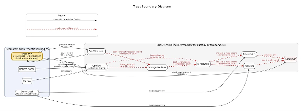
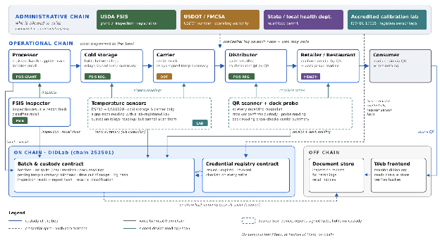

# Chuck and Verify — Checkpoint Report

Cumulative report, maintained across the semester. Sections appear as they become relevant and are then maintained for the rest of the semester. A PDF snapshot of this file is submitted at each checkpoint.

| Checkpoint | Deadline | Question |
| :--- | :--- | :--- |
| 1 — Foundation | Sunday, October 4, 2026 | Is this project real, and can this team ship? |
| 2 — On Chain | Sunday, October 18, 2026 | Does it actually touch the blockchain? |
| **3 — Functional** | Sunday, November 8, 2026 | Can someone who is not on your team actually use it? |
| 4 — Release Candidate | Sunday, November 29, 2026 | Is it finished? |

---

## 1. Project identity — name, team, roles, domain, repository

|                  |                                                                                                                                                                                    |
| :--------------- | :--------------------------------------------------------------------------------------------------------------------------------------------------------------------------------- |
| **Project Name** | Chuck and Verify                                                                                                                                                                   |
| **Project Team** | Team BB                                                                                                                                                                            |
| **Team Members** | Britt Huffman ([@brittshanklin](https://github.com/brittshanklin)) Bhavana Sriharika Kondapalli ([@bhavana-sriharika-kondapalli](https://github.com/bhavana-sriharika-kondapalli)) |
| **Domain**       | <https://teambb.didlab.org/>                                                                                                                                                       |
| **Repository**   | <https://github.com/teambb-blockchain/chuck-and-verify>                                                                                                                            |

## 2. Problem, stakeholders, and trust boundaries

### Problem

Beef passes through several stages and organizations before it reaches the consumer. During this process, distributors, retailers, restaurants, and consumers depend on inspection records to confirm that the meat has been properly inspected and is safe for consumption. A major concern is that inspection records can be altered, forged, or falsely claimed, making it difficult to confirm whether the information is genuine. In September 2026, FSIS issued a Class I recall due to the false mark of USDA inspection on over 167,000 pounds of meat products (U.S. Department of Agriculture, Food Safety and Inspection Service, 2026). Because of this false mark, retailers and restaurants unknowingly purchased meat with unreliable inspection information to sell to consumers. Another important component of beef safety is temperature during storage and transport. The FSIS issues standards for the safe temperature for beef storage and transport, but adherence to these standards is not independently verifiable by other custodians outside of the time of handoff. When a custodian has possession of the beef, they are both liable and self-reporting on the supply chain status and safety, giving them incentive for falsifying the claims they create and control without options for other parties to verify these claims. These factors can lead to health and safety concerns, financial losses, disruption from product recalls, and overall loss of trust in the beef supply chain by consumers. A method that is tamper-evident and independently verifiable for inspections, custody, and temperature is needed.

> U.S. Department of Agriculture, Food Safety and Inspection Service. (2026, September 22). *Star Meat Delivery Inc. recalls raw pork, beef, and goat products produced without the benefit of inspection*. <https://www.fsis.usda.gov/recalls-alerts/star-meat-delivery-inc--recalls-raw-pork-beef-and-goat-products-produced-without>

### Stakeholders

| Element                  | Prompt                                                                                                 | Our Answer                                                                                                                                                                                                                                                                                                                                                                                                                                                                                                                                                                                                                                                                                                                                                                                                                                                                                                                                                                |
| :----------------------- | :----------------------------------------------------------------------------------------------------- | :------------------------------------------------------------------------------------------------------------------------------------------------------------------------------------------------------------------------------------------------------------------------------------------------------------------------------------------------------------------------------------------------------------------------------------------------------------------------------------------------------------------------------------------------------------------------------------------------------------------------------------------------------------------------------------------------------------------------------------------------------------------------------------------------------------------------------------------------------------------------------------------------------------------------------------------------------------------------ |
| **Stakeholders**         | Who acts? Name every distinct party — "the hospital" and "the insurer" and "the patient", not "users". | USDA Food Safety and Inspection Service, USDOT Federal Motor Carrier Safety Administration, US FDA, State/Local Health Departments, Beef Processor, Storage Facilities, Distributors, Carriers, Retailers, Restaurants, Consumer                                                                                                                                                                                                                                                                                                                                                                                                                                                                                                                                                                                                                                                                                                                                          |
| **Assets**               | What is owned, transferred, claimed, or attested?                                                      | **Owned:** The beef batch is owned by the purchaser, and ownership changes with each sale. The temperature report during custody is owned by the custodian. **Transferred:** The beef batch is transferred from sending to receiving custodians. **Claimed:** The beef is claimed to be inspected and safe for consumption. The temperature during custody is claimed to be safe to the other parties by the custodian. **Attested:** The processor is attested by the USDA FSIS by inspection. The carrier's vehicle and driver safety are attested by the USDOT FMCSA. The restaurant is attested by a health inspection report by the State/Local Health Inspectors.                                                                                                                                                                                                                                                                                                   |
| **Transactions**         | What are the state-changing actions? Who initiates each?                                               | *USDA FSIS* — grant of inspection + revocation of inspection + classification of recalls + recall notifications *USDOT FMCSA* — USDOT numbers + operating authority *US FDA* — audit reports *State/Local Health Departments* — health inspections *Beef Processors* — beef batch registration + mark of inspection + recalls *Storage Facilities* — beef storage + shipping + receipt of shipment *Distributors* — receipt of shipment + splitting batch into smaller lots + distribution *Carriers* — transport of beef to recipient *Retailers* — selling of beef lots + receipt of shipment *Restaurants* — receipt of shipment + preparing for consumption                                                                                                                                                                                                                                                                                                           |
| **Records**              | What is written down today, by whom, and where does it live?                                           | *USDA FSIS* — grant of inspection records + revocations + pass/fail + recall classifications + notifications (federal government database) *USDOT FMCSA* — USDOT numbers + licenses to operate (federal government database) *US FDA* — audit records + pass/fail (federal government database) *State/Local Health Inspectors* — inspection records + pass/fail (state/local government database, health notices) *Beef Processors* — production and batch records (business database, paper records) *Storage Facilities* — inventory, temperature, orders and deliveries (business database, paper records) *Distributors* — orders, shipping and receiving status, temperature (business database, paper records) *Carriers* — travel logs, arrival times, temperature (business database, paper records) *Retailers* — sales (business database, paper records) *Restaurants* — inventory, menu (business database, paper records) *Consumer* — receipts of purchase |
| **Current Intermediary** | Who sits in the middle today? A company, a registry, a regulator, a spreadsheet someone emails.        | USDA FSIS is the intermediary for beef inspection but currently not intermediary across the supply chain for custody and temperature.                                                                                                                                                                                                                                                                                                                                                                                                                                                                                                                                                                                                                                                                                                                                                                                                                                     |
| **What goes wrong**      | The concrete failure. Fraud, delay, cost, dispute, loss, capture.                                      | **Fraud:** altered, forged or falsely claimed inspection records; falsified temperature readings **Delay:** access to beef due to recall disruptions **Cost:** financial losses due to misattributed liability or overly broad recalls **Dispute:** liability for beef product loss during recall **Loss:** health and wellbeing of consumers who ingest bad beef; trust in the beef supply chain by consumers                                                                                                                                                                                                                                                                                                                                                                                                                                                                                                                                                            |

### Trust boundaries

## 3. Suitability verdict and justification

**Verdict: PROCEED WITH REDESIGN**

A centralized database managed by the USDA is not suitable because it creates a single point of failure both by USDA employees non-maliciously modifying or entering incorrectly or by those who maliciously access the system. It also requires multiple parties across the supply chain to trust the USDA as the authoritative party, in addition to the other parties who provide records. A blockchain solution record cannot be altered once written, either by the USDA or other parties. The transparent lineage the blockchain solution offers also acts as both attribution and deterrence for fraud. Whether to avoid liability, meet quotas, make sales, or avoid reputational damage, the party with the biggest incentive for fraud is the self-reporting party. The operational chain captures the lineage which makes repeated offenses easier to investigate due to the same party showing repeatedly in recalls. The blockchain does not fix the incentive for inaccurate reporting or fraud but adds the administrative chain verifying parties which adds certification to their reporting in the supply chain and a mechanism for their removal for fraud, and the operational chain adds transparency of the certification, lineage, and temperatures. Both in conjunction aims to decrease the ease of malicious fraud and increase the visibility when it occurs repeatedly.

The suitability analysis completed led to three changes to our original design:

- Retail sales data was removed from the chain, so confidential business data is never public (M1-D1). See [decision record 0001](decisions/0001-keep-retail-sales-off-chain.md).
- Inspection and temperature reports stay off chain and are represented on chain only by their hash (M1-Q5).
- A custody handoff is recorded only when the receiving party confirms it, instead of the sender reporting it alone (M1-D4). The design used a QR scan; 0004 defers the scanner, and the receiver's own `confirmReceipt` call stands in for it.

A third party with no access to any participant's private systems can verify that a beef batch passed USDA inspection, which parties held it and in what quantities, whether safe temperatures have been maintained to FSIS standards during storage and transport, whether temperature readings are consistent across comparisons between the dock and carriers, and whether it has been recalled. This is done by confirming each entry was submitted by an address certified from the administrative chain that is not expired or revoked, by reading temperature and lineage records against the event history and checking inspection and temperature reports against the on-chain hashes on the public chain.

## 4. Architecture — diagram and component description

### Administrative Chain

- **Responsibility:** Certifies who or what can write on the operational chain.
- **Inputs and outputs:** Inputs are requests for credentials, while outputs are issuance, expiry, and revocation of credentials.
- **On-chain or off-chain:** Credential Registry Contract is on-chain, but issuing bodies are off-chain.
- **Who controls it:** USDA FSIS, USDOT FMCSA, State/Local Health Departments and Accredited Calibration Lab (for our simulation we will be acting as the administrative chain and hold the keys to write to the registry).
- **What it guarantees, and what it doesn't:** It guarantees only those with permission at the moment of the write can write on the operational chain, but does not guarantee that the holder has written accurately. It also does not guarantee the issuer is not compromised or hasn't made a mistake, nor that temperature sensors were located as reported.
- **Trust boundary:** This addresses the trust boundary between regulators and credentialing bodies and the supply chain operators.

### Operational Chain

- **Responsibility:** Records what happened to each beef batch from processing to final receipt: batch registration, inspection, custody handoffs, lot splits, temperature summaries, and recalls.
- **Inputs and outputs:** Inputs are writes from credentialed parties: the processor (batch registration, and recalls of its own batches with their USDA class), the FSIS inspector (inspection result and report hash), each receiving custodian (receipt confirmation and dock reading), the distributor (lot splits by weight), and cold storage and carriers (relayed signed temperature summaries). The output is a timestamped, attributable lineage for each batch that anyone can read.
- **On-chain or off-chain:** The records are on-chain; the parties and their business records are off-chain.
- **Who controls it:** Each credentialed party controls only its own writes and cannot alter another party's records. The consumer reads but cannot write.
- **What it guarantees, and what it doesn't:** It guarantees that each record was written by a party credentialed at the time, cannot be altered afterward, and that custody changes are confirmed by the receiver rather than reported by the sender alone. It does not guarantee the records are accurate. The chain establishes accountability, not accuracy.
- **Trust boundary:** The handoffs between custodians, where custody and temperature claims pass from one party to the next.

### Devices

- **Responsibility:** Capture physical facts such as temperature during storage and transport, and custody confirmation at each handoff.
- **Inputs and outputs:** Inputs are temperature readings from the temperature sensors, QR codes for the QR scanner. Outputs are signed temperature readings, summarized per leg as min/max, time out of range, and a log hash and dock reading for the temperature scanner and receipt confirmation for the QR scanner.
- **On-chain or off-chain:** The devices are off-chain but their outputs are written on-chain by the custodian or receiver.
- **Who controls it:** Custodians operate the devices. Sensor keys are registered by the accredited calibration lab, so a custodian can relay readings but cannot alter them without breaking the signature.
- **What it guarantees, and what it doesn't:** It guarantees that a reading came from a registered sensor and was not changed after signing, and that the receiver, not the sender, confirmed custody. However, it does not guarantee the sensor was physically with the beef, that the custodian relayed every reading rather than withholding readings, or that the QR scanner was used correctly.
- **Trust boundary:** Where physical conditions become digital records controlled by the custodian.

## 5. On-chain / off-chain data decisions

This table is the target design. The deployed `BeefSupplyChain` v3 stores a subset: batch id, weight, processor and holder addresses, the batch a lot was split from, inspection pass/fail with the encrypted report's hash, and recall class with the notice's hash. Dates come from block timestamps. Grade, recall number, processing and departure dates, and temperature are not stored yet, recalls are recorded by the processor that registered the batch, and custody is confirmed by the receiver's `confirmReceipt` call rather than a scan (0004).

| Element | On chain | Off chain | Justification |
| :--- | :--- | :--- | :--- |
| Production and batch records (processors) | Stakeholder, Batch #, lbs, processing date, date left facility | Business operations details — employee IDs, processes used, pricing | Recording the batch information on-chain creates the starting point for tracking the beef throughout the supply chain. The batch number identifies the product, while the weight helps track the quantity as the batch moves between parties or is divided into smaller lots. The processing and departure dates provide timestamped information for the batch's history. Employee IDs, processing methods, and pricing remain off-chain because they are internal business information and are not necessary to verify the batch's lineage. |
| Inspection records (USDA) | Certification of inspection, grade, date of inspection, hash of the inspection report | Full inspection report, detailed inspection information, certifier details | Recording the inspection result, grade, and date on-chain gives supply-chain participants a reliable way to check the batch's recorded inspection history. These fields show whether an inspection was completed, the quality grade assigned to the batch, and when the inspection took place. The complete inspection report and supporting details remain off-chain because they are not necessary for tracing the batch and would add unnecessary data to the blockchain. Instead, a hash of the report is stored on-chain, allowing the original document to be checked later to determine whether it has been changed. |
| Supply chain records / transport records (logistic partners) | Activity records — stakeholder, date received, date delivered to next partner, lbs | Truck numbers, employee IDs, detailed shipment information, internal logistics records | The transport records provide a timestamped history of the beef batch as it moves through the supply chain. Recording the stakeholder, transfer dates, and weight helps trace when the batch changes custody and how much beef is transferred or separated into smaller lots at each stage. This creates a clear record of the batch's movement and quantity throughout its journey. Detailed information such as truck numbers, employee IDs, and shipment records remains off-chain because it is supporting operational information and is not necessary for verifying the batch's transportation and custody history. |
| Custody scans (receiving party) | Batch #, scanning party, time of scan | Scan images, device logs, station details | The custody scan records that the receiving party confirmed possession of the batch at a specific time. The receiver scans the batch's QR code to confirm the handoff, preventing the sender from recording a completed delivery without confirmation from the other party. This creates a traceable custody transition as the beef moves through the supply chain. Scan images, device logs, and station details remain off-chain because they are operational information and are not necessary for verifying the recorded handoff. |
| Temperature monitoring (sensors) | Batch #, temperature summary, minimum/maximum temperature, time out of range, timestamp, hash of temperature log | Complete sensor readings, detailed temperature logs, device records | Temperature sensors continuously monitor the beef as it moves through processing, storage, transportation, and later stages of the supply chain. Real-time readings help identify when a batch moves outside the required temperature range and allow that condition to be associated with the batch and time it occurred. Because continuous sensor monitoring can produce a large amount of data, the complete temperature readings remain off-chain. Important temperature summaries, exceptions, timestamps, and a hash of the detailed temperature record are stored on-chain. This provides a traceable record of the batch's handling conditions while allowing the detailed sensor data to be verified later to determine whether the sensor records have been modified. |
| Retail records (retailers) | Activity records — stakeholder, date received, lbs received | Individual sales, daily sales volumes, pricing/dates, business operation details — employee IDs, registers, pricing | Recording the retailer, date received, and quantity on-chain continues the traceable history of the beef batch when it reaches the retail stage. These records show when the retailer received the batch and how much was transferred into its custody. Individual purchases, sales volumes, pricing, employee information, and register data remain off-chain because they contain internal business information and are not necessary for verifying the batch's inspection, custody, or supply-chain history. |
| Recall records (USDA) | Recall #, classification, recall date, hash of the recall notice | Recall reason, source of recall, documents created or referenced in the issue of the recall | Recording the recall number, classification, and date on-chain creates a permanent update to the batch's status when a recall occurs. This allows participants and consumers to identify that the affected batch has been recalled and understand the recorded severity of the recall. Detailed reasons and supporting documents remain off-chain because they contain additional information that does not need to be stored directly on the blockchain. A hash of the recall notice is recorded on-chain so the original notice can later be checked to determine whether it has been modified. |

## 6. Deployment record — contract addresses, deployment transactions, chain 252501

Both contracts are live on DIDLab chain **252501**. Deploy script: `scripts/deploy.js` (refuses any chain other than 252501). v3 commit: [`af2fb3c`](https://github.com/teambb-blockchain/chuck-and-verify/commit/af2fb3c); v2 was [`022bc9b`](https://github.com/teambb-blockchain/chuck-and-verify/commit/022bc9b) and v1 [`83d7418`](https://github.com/teambb-blockchain/chuck-and-verify/commit/83d7418). Live page: <https://teambb.didlab.org/> (Deployed contracts section). The live page still shows and calls v1 until the host is redeployed (§14, row 1).

| Contract | Address | Deployment transaction |
| :--- | :--- | :--- |
| **BeefSupplyChain v3** (current: lots and custody legs; [SECURITY_REVIEW §5](SECURITY_REVIEW.md)) | [`0x35c56b125da5d3e8CBFbB0e3f87cEC8CCD96b3e0`](https://explorer.didlab.org/address/0x35c56b125da5d3e8CBFbB0e3f87cEC8CCD96b3e0) | [`0xdb0037d7551dfd87a6fe19c132d842962a52e8d66b4ab4cda96a73349e3e71ab`](https://explorer.didlab.org/tx/0xdb0037d7551dfd87a6fe19c132d842962a52e8d66b4ab4cda96a73349e3e71ab) |
| BeefSupplyChain v2 (superseded 2026-11-11) | [`0x903359014d55A25ED1d4a8DCA6740dd30A90448a`](https://explorer.didlab.org/address/0x903359014d55A25ED1d4a8DCA6740dd30A90448a) | [`0xe97d465f82f1d64e266373674545e30cf50732a49d3938339cf780d10ad6b3f1`](https://explorer.didlab.org/tx/0xe97d465f82f1d64e266373674545e30cf50732a49d3938339cf780d10ad6b3f1) |
| BeefSupplyChain v1 (superseded 2026-11-08) | [`0x20bA1c398CD59b05dA4427162bdA7F26d5AB802e`](https://explorer.didlab.org/address/0x20bA1c398CD59b05dA4427162bdA7F26d5AB802e) | [`0xe7c3f5bd803f2a26cae4293658c17a9eef8d58966084901f9291036756072d89`](https://explorer.didlab.org/tx/0xe7c3f5bd803f2a26cae4293658c17a9eef8d58966084901f9291036756072d89) |
| **CredentialRegistry** | [`0x9ef5cb328aE86C968dDcb1Fd60887bd021D7AB2E`](https://explorer.didlab.org/address/0x9ef5cb328aE86C968dDcb1Fd60887bd021D7AB2E) | [`0x0666fbae85959f573ce04400a072ffce7506f05db951a09b22a63dcc959056da`](https://explorer.didlab.org/tx/0x0666fbae85959f573ce04400a072ffce7506f05db951a09b22a63dcc959056da) |

Deployer (creator) address: `0xb323821F0dFCf3b2E8727A7FBae2E34F0D4f393F`. BeefSupplyChain v2 was deployed from `0x87996A1051e98DD5586643c9a19B7C000A7eb5a8` against the same registry (block 7269167). v2 has no owner, so the deployer holds no special power over it. Records on v1, including `BEEF-001` below, did not migrate. BeefSupplyChain v3 was deployed from the same `0x8799…b5a8` against the same registry on 2026-11-11 (block 7384345, 1,449,370 gas). Its bytecode matches `af2fb3c` exactly once the registry slots are masked. It also has no owner, and records on v2, including `BEEF-A1-014` below, did not migrate: v3 has no batches yet.

**Sample Batch Registration and Verification**
We used `scripts/registerBatch.js` to register the sample batch `BEEF-001` on DIDLab chain 252501. The transaction was recorded in block 6223773.
Transaction hash: [`0x8f33623a90575c56720bf36ad627ed668784ac5113ea82a7eeee3f6b935dc712`](https://explorer.didlab.org/tx/0x8f33623a90575c56720bf36ad627ed668784ac5113ea82a7eeee3f6b935dc712)

We also checked the registered batch through the live website and confirmed that its information could be retrieved from the blockchain.

**Sample batch on v2.** `BEEF-A1-014` was registered by wallet A `0xc2Ad…351E` (PROCESSOR) in [`0x3fe163cb…72ca52`](https://explorer.didlab.org/tx/0x3fe163cbf7bc5029ff2d85293af077a507880d7e3109895a7e6f549b5272ca52), block 7271926, and inspected by wallet B `0x2710…3b5b` (INSPECTOR) in [`0xd1718894…00fd53`](https://explorer.didlab.org/tx/0xd1718894205be6af1fb5e44caccdf9ac548a007701acc616c3d751cbc200fd53), block 7271954, using the v2 frontend from a local server.

## 7. Features completed, with evidence

| Feature | What it does | Evidence |
| :--- | :--- | :--- |
| CredentialRegistry (simulated administrative chain) | Admin assigns one issuer per credential type (PROCESSOR, INSPECTOR, CUSTODIAN). That issuer alone may grant or revoke credentials of that type. `isValid` returns false when a credential is missing, revoked, or past `expiresAt`. | Contract: `contracts/CredentialRegistry.sol`, `contracts/ICredentialRegistry.sol`. Tests: `test/CredentialRegistry.test.js` — issuer-per-type isolation, revoke, and expiry. Commit: [`00680e9`](https://github.com/teambb-blockchain/chuck-and-verify/commit/00680e9) |
| BeefSupplyChain write path | Credential-gated writes for the operational chain: `registerBatch` (processor), `recordInspection` (inspector; stores report hash + pass/fail), `recordShipment` / `confirmReceipt` (custodian; custody completes only when the pending receiver confirms), `recordRecall` (the processor that registered the batch; stores notice hash + USDA class I–III, and a later recall can only escalate). Unauthorized callers revert with `Unauthorized`. v2 adds: an inspection is final (`AlreadyInspected`), none after a recall (`BatchRecalled`), and the batch's own processor cannot inspect it (`SelfInspection`). | Contract: `contracts/BeefSupplyChain.sol`. Tests: `test/BeefSupplyChain.test.js` — authorized and unauthorized cases for each write, plus an end-to-end register → inspect → ship → confirm → recall path and custom-error failure paths. Commits: [`00680e9`](https://github.com/teambb-blockchain/chuck-and-verify/commit/00680e9), [`845007e`](https://github.com/teambb-blockchain/chuck-and-verify/commit/845007e), [`ccee520`](https://github.com/teambb-blockchain/chuck-and-verify/commit/ccee520), v2 [`022bc9b`](https://github.com/teambb-blockchain/chuck-and-verify/commit/022bc9b) |
| Split a batch into lots (v3) | The current holder of a batch can split it once into 2–20 lots named after it (`BEEF-01-L1`, `BEEF-01-L2`, …), and each lot ships to its own custodian. The lot weights must add up to the batch weight; the portal can split into equal weights by default. A lot carries the batch's inspection and recall, including a recall recorded after the split. A split batch cannot ship as a whole, and lot names cannot be registered ahead of the split (BSC-10). | Contract: `splitBatch`, `getLotInfo`, `LotCreated` in `contracts/BeefSupplyChain.sol`. Tests: `splitBatch` in `test/BeefSupplyChain.test.js`, `lots` in `test/BeefSupplyChain.adversarial.test.js`, and the split batch in `test/portal.adversarial.test.js`. Portal: split card and dashboard Split button (`frontend/public/actions.js`, `dashboard.js`), lot links in the batch lookup (`app.js`), lot rows in the index (`server/chainIndex.js`). Commit: [`af2fb3c`](https://github.com/teambb-blockchain/chuck-and-verify/commit/af2fb3c). Not yet sent on chain. |
| Receiver-confirmed custody handoff | A shipment sets `pendingReceiver`; `currentHolder` updates only when that receiver calls `confirmReceipt`. Sender-only delivery claims are rejected (`NotCurrentHolder`, `NotPendingReceiver`, `NoPendingShipment`). | Same contract and tests as above (`recordShipment` / `confirmReceipt` describe blocks). |
| Deployed on DIDLab (chain 252501) | CredentialRegistry and BeefSupplyChain v3 are live on the course chain. The repository's frontend, scripts and dashboard index point at v3; the public page still points at v1 until the host is redeployed. | Addresses and deployment TXs in §6. Deploy script: `scripts/deploy.js`. Commits: v1 [`83d7418`](https://github.com/teambb-blockchain/chuck-and-verify/commit/83d7418), v2 [`022bc9b`](https://github.com/teambb-blockchain/chuck-and-verify/commit/022bc9b), v3 [`af2fb3c`](https://github.com/teambb-blockchain/chuck-and-verify/commit/af2fb3c) |
| Demo credential setup and sample batch | Scripts grant demo credentials and register a sample batch so the verify UI has an on-chain record to read (`BEEF-001` on v1; `BEEF-A1-014` on v2, §6). | `scripts/setupCredentials.js`, `scripts/registerBatch.js` (address now v3, which has no batches yet). Commits: [`83d7418`](https://github.com/teambb-blockchain/chuck-and-verify/commit/83d7418), [`022bc9b`](https://github.com/teambb-blockchain/chuck-and-verify/commit/022bc9b) |
| Live beef batch verification (read path) | Anyone can look up a batch on DIDLab via the project page: wallet/network status for chain 252501, optional Switch to DIDLab, and `getBatch` over the DIDLab RPC showing processor, weight, current holder, inspection flags, and recall status. | Live: <https://teambb.didlab.org/> — section Live Beef Batch Verification; default batch id `BEEF-001`. Source: `frontend/public/index.html`, `frontend/public/app.js`. Commits: [`83d7418`](https://github.com/teambb-blockchain/chuck-and-verify/commit/83d7418), [`de66ed3`](https://github.com/teambb-blockchain/chuck-and-verify/commit/de66ed3) |
| Portal sign-in and roles | Wallet sign-in with a signed message, sessions, and portal roles (ADMIN, PROCESSOR, INSPECTOR, CUSTODIAN) that decide which cards a wallet sees. The portal grants nothing on chain; the contracts check credentials. | `server/auth.js`, `server/db.js`, `frontend/public/session.js`; `test/portal.adversarial.test.js`. Commits: [`8a69070`](https://github.com/teambb-blockchain/chuck-and-verify/commit/8a69070), [`4c1fd14`](https://github.com/teambb-blockchain/chuck-and-verify/commit/4c1fd14), [`f557d66`](https://github.com/teambb-blockchain/chuck-and-verify/commit/f557d66), [`75acdd9`](https://github.com/teambb-blockchain/chuck-and-verify/commit/75acdd9) |
| Encrypted document upload | The lot form (at registration) and the inspection report (at inspection) are encrypted in the browser and published to DIDLab IPFS. Only the ciphertext's SHA-256 goes on chain, as the inspection's `reportHash`; the CID stays in the uploader's receipt. | `frontend/public/ipfs.js`, `frontend/public/app.js`. Evidence: `BEEF-A1-014` (§6), where the on-chain hash equals the SHA-256 of the bytes the gateway serves (Assignment 2 A1–A3). Commits: [`574e3f9`](https://github.com/teambb-blockchain/chuck-and-verify/commit/574e3f9), [`0dbc924`](https://github.com/teambb-blockchain/chuck-and-verify/commit/0dbc924) |
| Credential issuer admin | The registry admin can see and set the issuer for each credential type from the portal, and issuers grant credentials there. | `frontend/public/admin.js`, `frontend/public/registryAbi.js`. Commit: [`fc2c04b`](https://github.com/teambb-blockchain/chuck-and-verify/commit/fc2c04b) |

## 8. Testing evidence

| Suite | What it covers | Result |
| :--- | :--- | :--- |
| `test/CredentialRegistry.test.js` | Admin/`setIssuer`, issuer-per-type grant/revoke isolation, expiry and revocation making `isValid` false, zero-address and unauthorized issuer rejections | Passing under `npm test` |
| `test/BeefSupplyChain.test.js` | Authorized and unauthorized writes for register, inspect, ship, confirm, recall; end-to-end path; custom-error failure paths, including the v2 rules (`SelfInspection`, `AlreadyInspected`, `ZeroWeight`, `EmptyReportHash`, `NotBatchProcessor`, `RecallNotEscalated`) and an action refused after its credential is revoked; v3 lots (naming, every split refusal, independent lot shipping, inspection and recall read-through) and custody legs | 31 passing ([docs/evidence/D1_test_output.txt](evidence/D1_test_output.txt)) |
| `test/CredentialRegistry.adversarial.test.js`, `test/BeefSupplyChain.adversarial.test.js` | Every role boundary, hostile inputs, out-of-order calls; `FINDING` tests document accepted defects ([SECURITY_REVIEW](SECURITY_REVIEW.md)) | Passing under `npm test` |
| `test/portal.adversarial.test.js` | Runs the real portal server: sign-in domain, nonce replay, malleated signatures, session cookies, role checks on admin and upload routes, path traversal, framing | Passing under `npm test` |

`npm test` currently reports **150 passing** across all five suites (104 at Checkpoint 3, before lots and custody legs). At Checkpoint 2 it was 32 (CredentialRegistry + BeefSupplyChain), after the course scaffold contracts and `ProjectAnchor` tests were removed [`008233c`].

On-chain checks: sample batch `BEEF-001` is readable via Live Beef Batch Verification on <https://teambb.didlab.org/> against v1. On v2, `BEEF-A1-014` was registered and inspected from separate wallets, and a direct call from a wallet with no credential was refused (§9, **v2 checked on chain**).

## 9. Security and privacy review

Full review: [`docs/SECURITY_REVIEW.md`](SECURITY_REVIEW.md) (Guided Lab 3, 2026-11-08). This section summarises it.

**Scope.** Both contracts on chain 252501, plus the portal server (wallet sign-in, roles, IPFS upload) and the frontend's handling of private documents:

- `CredentialRegistry` [`0x9ef5…AB2E`](https://explorer.didlab.org/address/0x9ef5cb328aE86C968dDcb1Fd60887bd021D7AB2E)
- `BeefSupplyChain` v1 [`0x20bA…802e`](https://explorer.didlab.org/address/0x20bA1c398CD59b05dA4427162bdA7F26d5AB802e), superseded by v2 [`0x9033…448a`](https://explorer.didlab.org/address/0x903359014d55A25ED1d4a8DCA6740dd30A90448a)

**Method.**

- Every state-changing function was checked against the five classes: access control, input validation, reentrancy, unchecked external calls and state-ordering.
- Adversarial test suites probe every role boundary, feed hostile inputs and call functions out of order: `test/CredentialRegistry.adversarial.test.js`, `test/BeefSupplyChain.adversarial.test.js` and `test/portal.adversarial.test.js`. The portal suite runs the real server.
- An AI-assisted audit (Claude Code) made claims. Each one was confirmed by a test or refuted with a reason; four were false positives.
- Deployed bytecode was compared with the source builds, and checked again for v2 on 2026-11-08: it matches the current source.
- The v2 access rules were exercised on chain 252501 with separate wallets and a direct-call probe (see **v2 checked on chain** below).
- `npm test`: **104 passing**.

**Update, 2026-11-11.** v3 [`0x35c5…b3e0`](https://explorer.didlab.org/address/0x35c56b125da5d3e8CBFbB0e3f87cEC8CCD96b3e0) replaces v2. It keeps every v2 fix and adds lots and custody legs. Designing lots surfaced BSC-10 (a rival could register a lot's name first and block the split), fixed before deployment with `ReservedLotName`. v3's bytecode matches `af2fb3c`. `npm test`: 150 passing. Details: [SECURITY_REVIEW](SECURITY_REVIEW.md) §1, §3.2 and §5.

**Main results.**

| Finding | Severity | Outcome |
| :--- | :--- | :--- |
| The deployed `BeefSupplyChain` was not the reviewed source. Its bytecode matched an older commit in which **any inspector could recall any plant's batch** and the plant itself could not (BSC-0). | High | Fixed: v2 deployed; its bytecode matches the source exactly. |
| A failed inspection could be overwritten with a pass, including after a recall (BSC-1). | High | Fixed in v2: an inspection is final, and none is allowed after a recall. |
| A recall became impossible once the plant's credential expired or was revoked (BSC-4). | High | Fixed in v2: the processor of record can always recall its own batch. |
| One wallet holding PROCESSOR and INSPECTOR could pass its own batch (BSC-2). | Medium | Fixed in v2 (`SelfInspection`). |
| Recall class outside I–III, recall downgrades, zero weight and empty report or notice hashes were accepted (BSC-5, BSC-6). | Low | Fixed in v2. |
| A look-alike site could put its own domain into the wallet sign-in message and take over a portal session (P-1). Reproduced on teambb.didlab.org. | Medium | Fixed in code with regression tests; **not yet deployed to the host**. |
| Portal pages could be framed (P-6). | Low | Fixed in code; not yet deployed to the host. |
| Smaller registry input checks: grants to the zero address, never-expiring credentials (CR-3, CR-4). | Low | Deferred until the registry is redeployed. |

Clean findings:

- No reentrancy and no unchecked calls. The only external call is a read-only registry check, and its result is used.
- Sign-in nonces are single use.
- Malleated signatures are rejected.
- Session cookies are `HttpOnly` and `SameSite=Strict`, and the server stores only a hash of each session token.
- Cross-site form posts and path traversal are refused.

**v2 redeploy.**

- Tx [`0xe97d…b3f1`](https://explorer.didlab.org/tx/0xe97d465f82f1d64e266373674545e30cf50732a49d3938339cf780d10ad6b3f1), block 7269167. It reuses the existing registry.
- The frontend and scripts in the repository point at v2. **The live site still serves the v1 address and ABI** until the host is redeployed (§14, row 1), so v2 was exercised from a local `npm start`.
- Records written to v1 (including `BEEF-001`) did not migrate.

**v2 checked on chain (2026-11-08).**

| Check | Wallet | Result |
| :--- | :--- | :--- |
| Register batch `BEEF-A1-014` | wallet A `0xc2Ad…351E` (PROCESSOR) | Succeeded, [`0x3fe1…ca52`](https://explorer.didlab.org/tx/0x3fe163cbf7bc5029ff2d85293af077a507880d7e3109895a7e6f549b5272ca52), block 7271926 |
| Record its inspection with the encrypted report's hash | wallet B `0x2710…3b5b` (INSPECTOR) | Succeeded, [`0xd171…fd53`](https://explorer.didlab.org/tx/0xd1718894205be6af1fb5e44caccdf9ac548a007701acc616c3d751cbc200fd53), block 7271954. The on-chain hash equals the SHA-256 of the bytes the IPFS gateway serves. |
| Call `recordInspection` and `registerBatch` directly from the browser console, with the portal hiding both cards | a wallet with no credential | Both refused with `Unauthorized`. Simulated, nothing sent. Hiding a control protects nothing; the contract's credential check is the boundary. |
| Wallet A inspects its own batch | wallet A | Refused with `Unauthorized`, because wallet A holds no INSPECTOR and that check runs first. `SelfInspection` (BSC-2) is covered by tests but not yet shown on chain; showing it needs a short-lived INSPECTOR grant to wallet A. |

**Privacy.**

- Public on chain, by design (ADR 0001): lot codes, weights, custody addresses, inspection result and recall class.
- Inspection reports are encrypted in the browser before upload. Only a hash of the encrypted file goes on chain, so a report cannot be recovered by guessing its contents.
- The report's CID is not written on chain. It stays in the uploader's browser and downloaded receipt, so the chain holds no permanent public pointer to the encrypted file. The cost: anyone who loses the receipt cannot find the report from the chain alone.
- Wallet addresses are pseudonymous, not anonymous. Each address that acts in a role becomes that party's public identity, so role credentials should go to an organization's wallet, never an employee's personal one.
- Remaining privacy risks:
  - The encryption key comes from a wallet signature over a predictable message (P-2). This is DIDLab's required scheme, so it is accepted, with user guidance not to sign that message on any other site.
  - The saved upload details keep the original file name (P-3, open).
  - The signing library is loaded from a CDN without a pinned version (P-5, open).

**Residual risk and key management.**

- **One key controls the registry permanently.** The registry admin `0xb323…393F` is a single wallet that can never be replaced, and it is also the issuer for all three credential types (PROCESSOR, INSPECTOR and CUSTODIAN) and itself holds PROCESSOR. If it leaks, every record can be forged, and recovery means redeploying both contracts. We accept this for a course deployment; a real system would use a multisig admin.
- **Also accepted:**
  - Lot-code squatting by a rival plant (BSC-3).
  - Inspections cannot be corrected once recorded.
  - A revoked plant key can still recall its own batches. This fails safe: product is held, not released.
  - Revocation does not undo past records.

**Open before Checkpoint 4.**

1. Deploy the portal fixes and the current (v3) frontend to the DIDLab host (§14, row 1).
2. Grant CUSTODIAN to a second wallet. The CUSTODIAN issuer is set ([`0x2759…466f`](https://explorer.didlab.org/tx/0x2759a41fb9895676559b3cf1241d75e8c15777acd4e7d9aac9f832eaa576466f)) and wallet A holds CUSTODIAN ([`0x7fcd…4305`](https://explorer.didlab.org/tx/0x7fcdbb722303dad2450567b213f66ef67a9708a3f1ceab949cfe1b5ab2ab4305)), but a handoff needs a second custodian to confirm receipt (§14, row 2).
3. Move each issuer to a wallet other than the admin (§14, row 2).
4. Fix P-3 and P-5, match the page's upload limit to nginx's 1 MB, and verify the v3 source on the explorer (§14, row 9).
5. Complete the team's own five-class audit of both contracts and record what the AI audit missed.

## 10. Performance measurements

Measured on 2026-11-08. Gas comes from DIDLab transaction receipts on chain 252501. DIDLab has no base fee: every transaction below paid a flat 1 gwei, so the fee in TRUST is gas used × 10⁻⁹. Writes not yet sent to v2 were measured on the local Hardhat network with the same compiler settings (solc 0.8.24, optimizer 200 runs). For the two writes measured both ways, local and on-chain gas differ by less than 0.4%.

The chain and gateway figures can be reproduced with three read-only scripts [`961d880`, Bhavana Sriharika Kondapalli]: `scripts/measure-gas.js` reads the inspection receipt (64,264 gas, block 7271954), `scripts/measure-performance.js` times RPC reads and gateway downloads, and `scripts/tamper-demo.js` confirms the bytes the gateway serves still match the anchored digest and that one flipped bit changes the hash. Each runs with `node scripts/<name>.js` and needs no wallet or key.

### Gas per write on DIDLab

| Write | Sent by | Gas used | Fee (TRUST) | Transaction |
| :--- | :--- | ---: | ---: | :--- |
| `registerBatch` (v2) | processor, wallet A | 153,047 | 0.000153 | [`0x3fe1…ca52`](https://explorer.didlab.org/tx/0x3fe163cbf7bc5029ff2d85293af077a507880d7e3109895a7e6f549b5272ca52) |
| `recordInspection` (v2) | inspector, wallet B | 64,264 | 0.000064 | [`0xd171…fd53`](https://explorer.didlab.org/tx/0xd1718894205be6af1fb5e44caccdf9ac548a007701acc616c3d751cbc200fd53) |
| `grant` (registry) | issuer | 71,456–71,468 | 0.000071 | [`0xd9c8…5efa`](https://explorer.didlab.org/tx/0xd9c8e1cc7807ee6418d2c22661ba3aea6de0304facaa1d02ec631fd81b7a5efa) and 3 others |
| `setIssuer` (registry) | admin | 46,542–46,554 | 0.000047 | [`0x2759…466f`](https://explorer.didlab.org/tx/0x2759a41fb9895676559b3cf1241d75e8c15777acd4e7d9aac9f832eaa576466f) and 2 others |
| Deploy `BeefSupplyChain` v3 | deployer | 1,449,370 | 0.001449 | [`0xdb00…71ab`](https://explorer.didlab.org/tx/0xdb0037d7551dfd87a6fe19c132d842962a52e8d66b4ab4cda96a73349e3e71ab) |
| Deploy `BeefSupplyChain` v2 | deployer | 841,913 | 0.000842 | [`0xe97d…b3f1`](https://explorer.didlab.org/tx/0xe97d465f82f1d64e266373674545e30cf50732a49d3938339cf780d10ad6b3f1) |
| Deploy `CredentialRegistry` | admin | 372,522 | 0.000373 | [`0x0666…56da`](https://explorer.didlab.org/tx/0x0666fbae85959f573ce04400a072ffce7506f05db951a09b22a63dcc959056da) |

### Gas per write, local Hardhat (not yet sent on chain)

| Write | Gas used | Note |
| :--- | ---: | :--- |
| `recordShipment` | 39,658 | Holder names the receiver |
| `confirmReceipt` | 41,858 | Custody moves only here |
| `recordRecall` | 95,765 | Average over first recalls and escalations |
| `revoke` (registry) | 31,772 | |
| `splitBatch` (v3), 2 lots | 371,980 | About 154,000 per lot plus the checks |
| `splitBatch` (v3), 3 lots | 526,313 | |
| `splitBatch` (v3), 20 lots | 3,150,472 | The cap; 67% of DIDLab's 4,700,000 block gas limit |

**One batch, end to end on v2:** register, inspect, ship and confirm come to about 298,800 gas, or 0.0003 TRUST. A recall adds about 95,800. The largest single write, `registerBatch`, uses 3.3% of DIDLab's 4,700,000 block gas limit.

**The cost of the v2 security fixes.** The same inspection costs 59,778 gas on v1 ([`0x4c78…acfb`](https://explorer.didlab.org/tx/0x4c7840776bdbebbd227773c8a3706d0b168fecb65b1daf739c7601a57c9dacfb)) and 64,264 on v2, 4,486 more (+7.5%), for the checks that make an inspection final, refuse one after a recall, and refuse the batch's own processor. Registration is unchanged (152,988 on v1, 153,047 on v2). Deploying v2 cost 38,749 more gas than v1 (+4.8%).

### Latency

| Measurement | Result | Method |
| :--- | :--- | :--- |
| Block interval | 2.0 s | Average over the 1,000 blocks before block 7,278,442 |
| `getBatch` read over the DIDLab RPC | median 35 ms, 90th percentile 80 ms | 20 calls for `BEEF-A1-014` from a development machine; depends on the reader's network |
| RPC round trip (`eth_blockNumber`) | 24–25 ms; 105 ms on the first call | 3 calls, `scripts/measure-performance.js` |
| Fetch the encrypted report from the IPFS gateway | 0.12–0.32 s for 563,134 bytes | 9 downloads of `QmRQskDg…CtaYCnzD` over two runs, including `scripts/measure-performance.js`; the first download in each run was slowest |
| Integrity of the served report | SHA-256 matches the anchored `reportHash`; flipping 1 of 4,505,072 bits changes it | `scripts/tamper-demo.js` |

A write is final once it is in a block, so a confirmed transaction appears on chain within about one 2-second block of being accepted. Not measured yet: the time to encrypt and upload a report, and the time a user spends approving wallet prompts. Both need the user's wallet and are carried with §14, row 3.

## 11. AI development record

See also [AI_RECORD.md](../AI_RECORD.md) for the running log. This section covers Checkpoint 3, since the Checkpoint 2 report on 2026-10-18.

| Field | Entry |
| :--- | :--- |
| Tools used (or "none") | Cursor agent, Claude Code, Claude |
| What you asked for | **Cursor agent:** Serve the page at the site root without the `/frontend/` bounce, update it from `BatchRegistered`, add the lab frontend under `frontend/` with an ABI generated from the artifact, and publish a form uploaded from this device when a batch is registered. **Claude Code:** Bring the relevant lab deploy and credential scripts onto main; add portal roles with wallet sign-in; record recalls as the registering plant; fix sign-in on the DIDLab host; add issuer setup, asset stamping, and the Record Inspection card; write the security and privacy review; apply its contract fixes and redeploy BeefSupplyChain as v2; produce the on-chain evidence table; and base the mock inspection record on FSIS Form 6200-14. **Claude Code (evidence and report session):** gather on-chain evidence for anchoring and authorization on v2, check the authorization tests, draft §9, §10, §13 and §14, find and fix conflicts across the report, and produce the PDF snapshot. **Claude:** Clean up and review the Checkpoint 3 report. |
| What it produced | **Cursor agent:** The page under `frontend/public`, the `BatchRegistered` watcher, and browser encryption that publishes only the ciphertext. **Claude Code:** `scripts/deploy.js` and `scripts/setupCredentials.js`, the portal (sign-in, roles, issuer setup, the inspection card, and `npm run stamp`), the change so only the registering plant can recall, [`SECURITY_REVIEW.md`](SECURITY_REVIEW.md) with the three adversarial suites, the on-chain evidence tables, and the mock 6200-14 disposition records. The review session proposed the contract fixes; a following session applied them as BeefSupplyChain v2 and redeployed it (`0x9033…448a`, `022bc9b`). In the evidence and report session: the v2 evidence for `BEEF-A1-014` (§6, §9), a tightened revoked-credential test and `docs/evidence/D1_test_output.txt`, `.gitignore` rules for recovery files, drafts of §9, §10, §13 and §14, and the PDF snapshot. **Claude:** A cleanup and review of this checkpoint report. |
| How you verified it | **Cursor agent:** The page was loaded locally and batch `BEEF-001` was read from DIDLab. A missing wallet left that record unchanged. No live `registerBatch` or signed upload was sent in those sessions. **Claude Code:** `npm test` after the migration (32 passing), the recall change (35), and the security review (92). Portal checks ran on a local server, including a stand-in proxy that strips `/api`. Issuer setup was simulated locally; the team sent the signed grant. The review compared deployed bytecode with local builds: the registry matched HEAD, and the supply chain matched commit `83d7418`. After the v2 redeploy, the `FIXED BSC-*` regression tests passed, and the deployed v2 bytecode matched the build. The inspection transaction that would anchor a report hash had not been sent in that session; wallet B sent it later on v2 (§6). In the evidence and report session, every transaction was read back from the DIDLab RPC, the anchored hash was checked against the bytes the IPFS gateway serves, deployed v2 bytecode was compared with the source, `npm test` reported 104 passing, and the §10 numbers were cross-checked against `scripts/measure-gas.js`, `scripts/measure-performance.js` and `scripts/tamper-demo.js`. **Claude:** The revised checkpoint text was read against the sections it cites and against [AI_RECORD.md](../AI_RECORD.md). |
| What it got wrong | **Cursor agent:** The first upload pass hardcoded sample form filenames and offered them as a menu. That catalog was removed. On the lab-layout pass, a newly connected address was presented as able to register a batch, and the server resolved pages from an allowlist that would not serve the script and styles. **Claude Code:** Sign-in was first blamed only on a stale Node process. That process was holding the port, and the remaining cause was the nginx `proxy_pass` slash stripping `/api`. A hard refresh was said to fix the stale scripts; it clears the browser cache only. The inspection card first showed hashes and CIDs, and that copy was cut. The security review first counted a custody move after a recall as a defect, and its first Host-header test passed because `fetch` ignores `Host`. The first evidence table left out the digest and CID lines. The first mock disposition record used its own layout, and the passed fill counted one carcass twice. In the evidence and report session, the first anchor evidence used an inspection sent to v1 before checking which contract the live site called; the lot form's upload receipt was first taken for the inspection's; the self-inspection demonstration was planned before checking that wallet A held no INSPECTOR, so it reverts `Unauthorized`; and a §10 timing was first attributed to "a laptop on home broadband", which it could not know. **Claude:** Nothing noted for the document review. |

## 12. Individual contributions

| Member Name | Number of commits | What they contributed |
| :--- | :--- | :--- |
| Britt Huffman | 22 | Deploy and credential-setup changes brought onto main, with a pre-flight simulation of `registerBatch` [`ac4dedf`]. The DApp served at the site root [`eda4ab5`]. Live-page handling of `BatchRegistered` [`9fd2f1b`]. The frontend split into contract-interaction files [`f97d598`]. A message when the user cancels the wallet connection [`9d45db2`]. Encrypted IPFS upload of the lot form during batch registration [`574e3f9`]. Portal roles and wallet sign-in [`8a69070`], then the portal store switched from SQLite to JSON [`4c1fd14`]. Recalls limited to the processor that registered the batch [`ccee520`]. Wallet sign-in fixed on the DIDLab host [`f557d66`]. Keccak256 for portal signature recovery [`75acdd9`]. Admin pages for credential issuers [`fc2c04b`]. Content-hashed frontend asset URLs [`32c2f6c`]. Inspection-report upload on the frontend [`0dbc924`]. BeefSupplyChain v2 fixes and the redeploy to chain 252501 [`022bc9b`]. Adversarial tests for both contracts and the portal [`4cca9fe`]. The AI record [`5a343e8`], a frozen copy of the v1 contract for the review [`d2a3cb0`], the security review and this report [`dd2a582`], saved BeefSupplyChain test output [`59b1114`], and later report, AI record and security-review updates [`9500848`, `c3f40a9`]. |
| Bhavana Sriharika Kondapalli | 2 | MetaMask batch registration and transaction-status handling on the live page [`fa3f764`]. IPFS integrity and blockchain performance measurement scripts: `scripts/tamper-demo.js` checks the stored report's SHA-256 against the anchored digest, and `scripts/measure-gas.js` and `scripts/measure-performance.js` read gas from the inspection receipt and time RPC and gateway requests [`961d880`]. |

Commit counts are non-merge commits on `main` since the Checkpoint 2 report commit [`ec7d8e5`] (2026-10-18). The merge of that migration [`ec97bb0`] is empty and is not counted.

## 13. Risks, blockers, and what went wrong

### Risks

| Risk | Impact | Mitigation |
| :--- | :--- | :--- |
| One wallet holds the registry admin role and is the issuer for all three credential types (`0xb323…393F`) | A leaked key can grant any credential and forge any future record. `admin` is immutable, so recovery means redeploying both contracts | Move each issuer to its own wallet (§14, row 2). A multisig admin is noted for production in the security review. |
| The temperature work (sensor credential, signing path, summary write) has not started, with three weeks to the release candidate | Temperature, one of the three claims in §3, would ship as a design only | Apply the 0004 cut rule: if the software signer misses its date, the hardware path is cut and the software signer stands in for the sensor (§14, rows 4–6). |
| A report's CID is kept only in the uploader's browser and in the downloaded receipt. The chain stores only the report hash, a choice we kept for privacy | If both are lost, the encrypted report still exists on IPFS but cannot be found from the chain | Users keep the receipt file. Recovery files stay out of the repository (`.gitignore`). An off-chain CID index can be added later without changing the contract. |
| Commit evidence is uneven between members (§12) | The course grades each member on their own commits | Checkpoint 4 rows are split between both members (§14). |

### Blockers

- **Shipping and receipt cannot be shown on chain yet.** The CUSTODIAN issuer is set, but only wallet A (`0xc2Ad…351E`) holds CUSTODIAN ([`0x7fcd…4305`](https://explorer.didlab.org/tx/0x7fcdbb722303dad2450567b213f66ef67a9708a3f1ceab949cfe1b5ab2ab4305)). A handoff needs a second credentialed custodian to confirm receipt.
- **The temperature write depends on rows 4 and 5 of §14.** The contract cannot check a reading's signature until the sensor credential and the signed byte layout exist (0002, 0004).
- **Deploying the site needs manual access to the DIDLab host.** `/srv/app` is a copy, not a git checkout: each deploy is stamp, push, copy, and restart Node.

### What went wrong

- **Most of the Checkpoint 3 plan was not delivered.** Rows 1–4 and 6 of the Checkpoint 3 plan (sensor credential, signing path, ESP32, temperature write, history view) were not started, and the signing feasibility test carried from Checkpoint 2 still has not run. The checkpoint's commits went to the portal (sign-in, roles, encrypted uploads, inspection card), the security review, and the v2 fix.
- **The deployed contract was not the code we reviewed.** Comparing bytecode showed the live v1 contract matched an older commit in which any inspector could recall any plant's batch (BSC-0). We found this only during the security review. We now compare deployed bytecode with the source after every deploy.
- **The contract was redeployed but the site was not.** The first inspection recorded for Assignment 2 ([`0x4c78…acfb`](https://explorer.didlab.org/tx/0x4c7840776bdbebbd227773c8a3706d0b168fecb65b1daf739c7601a57c9dacfb), batch `BEEF-001`) went through the live site to v1 and had to be redone on v2 from a local server: batch `BEEF-A1-014`, registered by wallet A ([`0x3fe1…ca52`](https://explorer.didlab.org/tx/0x3fe163cbf7bc5029ff2d85293af077a507880d7e3109895a7e6f549b5272ca52)) and inspected by wallet B ([`0xd171…fd53`](https://explorer.didlab.org/tx/0xd1718894205be6af1fb5e44caccdf9ac548a007701acc616c3d751cbc200fd53)).
- **The DIDLab host behaved differently from local runs.** nginx strips the `/api` prefix and drops `Host`, which broke wallet sign-in, and Cloudflare cached old scripts for four hours after a deploy. Both are now handled in code (`index.js`, `server/auth.js`, `npm run stamp`), but each cost a debugging session.

## 14. Plan for the next checkpoint

### Checkpoint 3 plan: outcome

| # | Deliverable | Outcome |
| :--- | :--- | :--- |
| 1 | Sensor credential type | Not started. Carried (row 4 below). |
| 2 | Software signing path | Not started. Carried (row 5). |
| 3 | ESP32 signing path | Not started. Carried (row 6) under the 0004 cut rule. |
| 4 | Temperature summary write | Not started. Carried (row 7). |
| 5 | Redeploy with separate wallets for each role | Partly done. v2 is deployed against the existing registry. Wallet A holds PROCESSOR and CUSTODIAN and wallet B holds INSPECTOR, and the v2 register and inspect steps were sent from those wallets. Ship, confirm, temperature and recall are not yet on v2. The admin still holds PROCESSOR itself and is the issuer for every type. Carried (row 2). |
| 6 | Full batch history on the site | Not started. Carried (row 8). |
| 7 | Update PROPOSAL.md and README to current scope | Not done: the README still lists no contract addresses. Carried (row 10). |
| 8 | Security and privacy review (§9) | Done. [`SECURITY_REVIEW.md`](SECURITY_REVIEW.md), adversarial suites, and the v2 fixes; 104 tests passing. |
| 9 | Performance measurements (§10) | Mostly done. §10 has DIDLab gas for every write sent on v2 and the registry, local gas for ship, confirm and recall, and latency. On-chain gas for ship, confirm and recall, and upload timing, are carried (row 3). |

### Checkpoint 4 plan (release candidate, November 29)

| # | Deliverable | Owner | Done when |
| :--- | :--- | :--- | :--- |
| 1 | Deploy the current frontend (v3) and the portal fixes (P-1, P-6) to the DIDLab host | Britt Huffman | The live `chain.js` names `0x35c5…b3e0`, `/api/me` returns JSON, and a sign-in started from an unlisted origin does not get that origin's domain in its message |
| 2 | Full lifecycle on the current contract (v3) with a separate wallet for each issuer and each holder | Bhavana Sriharika Kondapalli | `issuerOf` returns a wallet other than the admin for each type; a second custodian holds CUSTODIAN; §6 lists one v3 transaction per step (register, inspect, split, ship a lot, confirm, recall), each sent from the wallet holding that role |
| 3 | Performance measurements (§10) | Britt Huffman | §10 reports gas used for every v3 write type from the row 2 receipts |
| 4 | Sensor credential type in CredentialRegistry, with its own issuer standing in for the calibration lab (0003) | Britt Huffman | Tests pass for grant, revoke and expiry of a sensor credential, and a wrong-type issuer cannot grant it |
| 5 | Software signing path: a script signs a reading in a fixed byte layout and a contract view recovers the signer (0004, stages 1–3) | Britt Huffman | The recovered address matches the registered sensor key; a tampered message, a wrong key and an unregistered key each fail; the byte layout is committed in one shared file. If not met, hardware is cut (0004) |
| 6 | ESP32 signing path (0004, stage 4) | Britt Huffman | Row 5's checks pass with a device-produced signature. If not met, the software signer becomes the stand-in sensor and 0004 is superseded |
| 7 | Per-leg temperature summary write in BeefSupplyChain: min/max, time out of range, timestamp, log hash, with the sensor signature checked on chain (0002) | Bhavana Sriharika Kondapalli | Tests pass for an authorized write, an unauthorized caller, an invalid signature and a replayed reading; the write is deployed and appears in §6 |
| 8 | Batch history on the site: inspection, custody chain, temperature summaries and recall status | Bhavana Sriharika Kondapalli | Entering a batch ID on teambb.didlab.org renders every record from row 2, read from chain 252501 in pages that stay under the RPC block limit |
| 9 | Close the open review items | Britt Huffman | P-3 (original file name kept in the upload receipt) and P-5 (unpinned signing library) are fixed; the form limit matches nginx's 1 MB; the v3 source is verified on the explorer so event fields show by name |
| 10 | Update PROPOSAL.md and README to the current scope (carried since Checkpoint 2) | Bhavana Sriharika Kondapalli | PROPOSAL.md scope matches 0002–0004; README lists the current BeefSupplyChain and registry addresses and the commands to test, deploy and stamp |

## 15. Change log — what changed since the previous checkpoint and why

### Since Checkpoint 3 (for Checkpoint 4)

- A custodian can split a batch into lots. The holder splits a batch once into 2–20 lots named after it (`BEEF-01-L1` …), with weights that add up to the batch weight, and each lot then ships to its own custodian. Lots read their inspection and recall from the batch they came from, so a split cannot hide a failed inspection or a recall, and a recall after the split still reaches every lot. Lot names are reserved, so a rival cannot block a split by registering one first (BSC-10). The portal adds a split card (equal weights by default), a Split button on dashboard rows, and lot links in the batch lookup [`af2fb3c`, Britt Huffman].
- `custodyLeg` counts confirmed receipts so a separate temperature contract can tie its records to one holder's leg (ADR 0005).
- BeefSupplyChain v3 replaces v2: [`0x35c5…b3e0`](https://explorer.didlab.org/address/0x35c56b125da5d3e8CBFbB0e3f87cEC8CCD96b3e0), deploy transaction [`0xdb00…71ab`](https://explorer.didlab.org/tx/0xdb0037d7551dfd87a6fe19c132d842962a52e8d66b4ab4cda96a73349e3e71ab), block 7384345, reusing CredentialRegistry `0x9ef5…AB2E`. The frontend, `scripts/registerBatch.js` and the dashboard index now use v3. v2 still holds `BEEF-A1-014`; those records were not copied. `npm test`: 150 passing.

### Design and scope changes

- Recall is the registering plant's action. v2 `recordRecall` reverts `NotBatchProcessor` unless the caller is `batch.processor`. That plant can still recall after its PROCESSOR credential expires or is revoked, because a recall holds product and an offboarded plant has to be able to pull its own lots. Classification is USDA Class I–III, and a later recall has to use a stricter class (`RecallNotEscalated`), so the notice cannot be swapped at the same class. The Checkpoint 2 contract did the reverse: any inspector could recall any plant's batch, and the plant could not ([SECURITY_REVIEW](SECURITY_REVIEW.md) BSC-0, BSC-4, BSC-5). Assignment 2 C1 states the same split.
- An inspection is a single write, and the plant that registered the batch cannot be the one who inspects it. v2 reverts `AlreadyInspected` on a second inspection, `BatchRecalled` after a recall, and `SelfInspection` when the caller is `batch.processor`, even if that address also holds INSPECTOR. A wrong inspection cannot be corrected on this contract. The refusals are in the Hardhat tests (Assignment 2 D1). The live attempt, wallet A calling `recordInspection` on its own batch, is still open (Assignment 2 C3, row 3). The check is the lab rule that the submitter cannot verify its own record, applied here as `SelfInspection`.
- The inspection report is encrypted in the browser, and the chain stores the hash of the ciphertext. AES-256-GCM, key from a wallet signature. IPFS receives the ciphertext. `recordInspection` takes that SHA-256 as `reportHash`. The CID stays in the portal receipt: a verifier who has it hashes the gateway bytes and compares them to the chain. For `BEEF-A1-014` the gateway, the upload receipt, and `InspectionRecorded` are the same digest (`cb48afdd…75dd095`). Anchoring transaction [`0xd1718894…00fd53`](https://explorer.didlab.org/tx/0xd1718894205be6af1fb5e44caccdf9ac548a007701acc616c3d751cbc200fd53), block 7271954, 64,264 gas, from inspector `0x2710…3b5b` (Assignment 2 A1, A3). The filename stays off the calldata and out of that report.
- Processor and inspector are different wallets on the project registry. Wallet A `0xc2Ad…351E` holds PROCESSOR and registered `BEEF-A1-014` ([`0x3fe163cb…72ca52`](https://explorer.didlab.org/tx/0x3fe163cbf7bc5029ff2d85293af077a507880d7e3109895a7e6f549b5272ca52), block 7271926). Wallet B `0x2710…3b5b` holds INSPECTOR and recorded the inspection. Neither holds the other's credential (Assignment 2 C2, C3). Grants: PROCESSOR [`0xe108a04e…d7b6ab`](https://explorer.didlab.org/tx/0xe108a04ea965ed854674a594b95a79e6ce58cb911befd66b8a31f155cfd7b6ab), INSPECTOR [`0xd9c8e1cc…a5efa`](https://explorer.didlab.org/tx/0xd9c8e1cc7807ee6418d2c22661ba3aea6de0304facaa1d02ec631fd81b7a5efa). The admin `0xb323…393F` is still the issuer for all three types and still holds PROCESSOR. The CUSTODIAN issuer is set ([`0x2759…466f`](https://explorer.didlab.org/tx/0x2759a41fb9895676559b3cf1241d75e8c15777acd4e7d9aac9f832eaa576466f), block 7270656) and wallet A holds CUSTODIAN, but no second wallet does, so no handoff can complete on v2 yet. Checkpoint 2 used one address as admin, issuer, and holder. The rest of that split — a distinct admin, a distinct issuer per type, and a custodian holder — is still open (§14, row 2).
- The portal chooses which cards a signed-in wallet sees. It grants nothing on chain. A wallet with no portal role and no credential called `recordInspection` and `registerBatch` through the page's own client. Both simulations returned `Unauthorized` (`0x82b42900`), and nothing was sent (Assignment 2 D2, sender `0xd488…b861`).
- Temperature is still not a write on `BeefSupplyChain` (0002). The Checkpoint 2 log scheduled that write for this checkpoint, and it was not added. Sensors and the physical scanner stay deferred (0004). Custody is still `recordShipment` then `confirmReceipt`; a handoff on v2 still waits on a second wallet holding CUSTODIAN to confirm receipt.

### Other changes

- At Checkpoint 3, BeefSupplyChain v2 was the contract the repository's frontend and scripts called (v3 replaced it on 2026-11-11; see above). The live site still serves v1 until the host is redeployed (§14, row 1). Deploy transaction [`0xe97d465f…ad6b3f1`](https://explorer.didlab.org/tx/0xe97d465f82f1d64e266373674545e30cf50732a49d3938339cf780d10ad6b3f1), block 7269167, from `0x8799…b5a8`, reusing CredentialRegistry `0x9ef5…AB2E`. v2 has no owner. v1 [`0x20bA…802e`](https://explorer.didlab.org/address/0x20bA1c398CD59b05dA4427162bdA7F26d5AB802e) still holds `BEEF-001`; those records were not copied [`022bc9b`, Britt Huffman].
- Two earlier DIDLab deployments are not used by this checkpoint: CredentialRegistry `0x3eC1…38B2` with BeefSupplyChain `0x981a…83D8`, where one wallet was admin, issuer, and every holder, and the lab `AnchorRegistry`. [SECURITY_REVIEW](SECURITY_REVIEW.md) §1 lists that pair as superseded. At Checkpoint 3 the frontend, the scripts, and §6 used `0x9ef5…AB2E` and `0x9033…448a`; they now use `0x9ef5…AB2E` and v3 `0x35c5…b3e0`.
- A zero weight and an empty report or notice hash revert (`ZeroWeight`, `EmptyReportHash`, `EmptyNoticeHash`).
- The D1 authorization run is saved at [docs/evidence/D1_test_output.txt](evidence/D1_test_output.txt) (31 passing in `test/BeefSupplyChain.test.js`). The full suite, including the adversarial tests, is 104 passing (§9).
- The security review is [docs/SECURITY_REVIEW.md](SECURITY_REVIEW.md). The portal sign-in and framing fixes are in the repo and are not on the DIDLab host.
